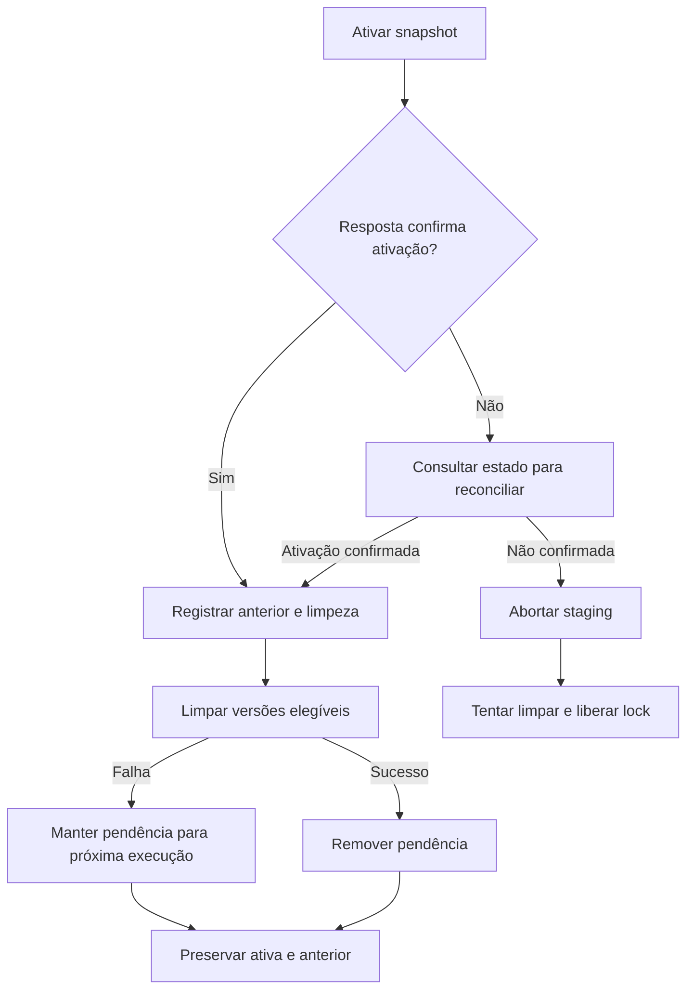

  

# Recuperação de snapshots

A rotina reconcilia ativação ambígua e tenta limpar versões descartadas sem remover ativa ou anterior.

## Falhas e limites

As etapas de limpeza e liberação toleram falhas e registram log, e uma ativação confirmada não é revertida por falha posterior de limpeza. A recuperação não dispensa a revisão manual de um snapshot legítimo com queda grande.

Fonte em [implementação](https://github.com/Solierrr/database-bootstrap/blob/main/src/graphs/snapshot/reconcile_activation.cypher). O contexto está em [feed de recomendações](https://github.com/Solierrr/docs-warehouse/blob/main/docs/flows/RECOMMENDATION_FEED.md).
